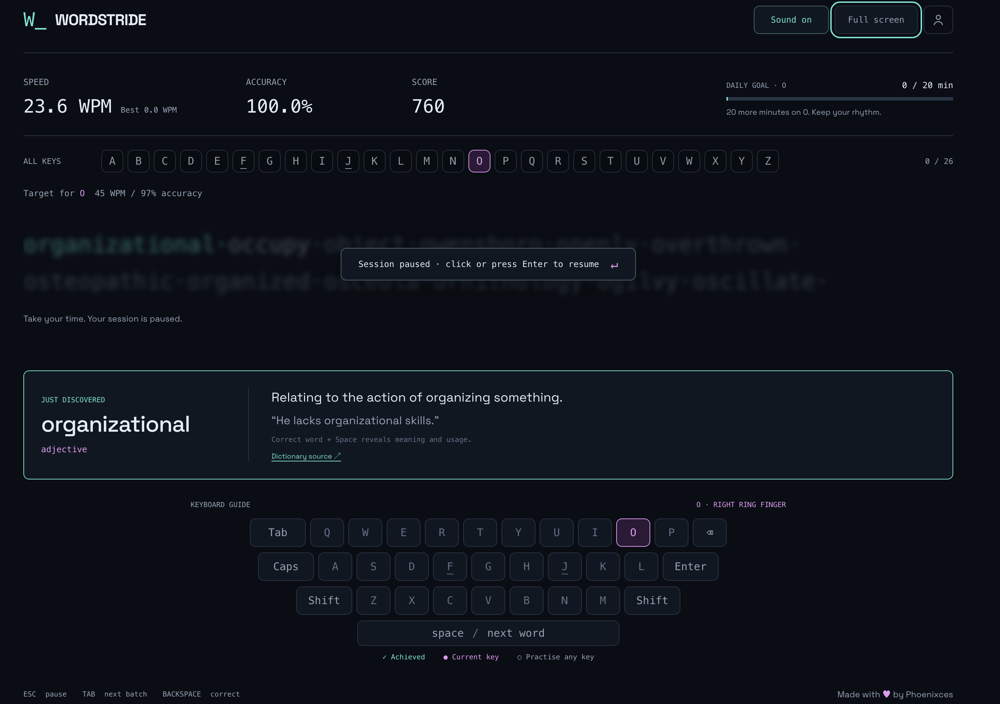

# WordStride

**Type faster. Learn as you go.**

WordStride adds vocabulary discovery to the familiar speed-and-accuracy drill. Type a word correctly and press Space to explore its meaning and usage, with a cheerful success chime along the way. A minimal cyberpunk interface keeps your focus on the next word.

[](https://canva.link/r8ktzaqrj9gh4ha)

[▶ Watch demo](https://canva.link/r8ktzaqrj9gh4ha)

- **Your letter, your pace.** Pick A–Z, set individual speed, accuracy, and daily goals, and earn checkmarks by meeting your targets.
- **Fresh practice, visible progress.** Get 25 randomly selected words per batch and track your best WPM for each starting letter.
- **Open and type.** No account needed. Settings and progress stay saved in your browser.

Built with React, TypeScript, Vite, and plain CSS.

## Quick start

Requires Node.js 20.19+ (or 22.12+ on Node 22).

```sh
npm install
npm run dev
```

## Commands

| Command | Purpose |
| --- | --- |
| `npm test` | Run unit and integration tests |
| `npm run build` | Check types and build to `dist/` |
| `npm run test:e2e` | Run browser tests¹ |
| `npm run data:check` | Verify the English word dataset |
| `npm run data:build` | Regenerate word files from the pinned source |

¹ Run `npx playwright install chromium` once before browser tests.

## References

- Design documents: [Overview](design-docs/01-overview.md) · [Architecture](design-docs/03-architecture.md)
- [English dataset source and licensing](third-party/zxcvbn/SOURCE.md)
- [Free Dictionary API](https://dictionaryapi.dev/) — definitions and usage
