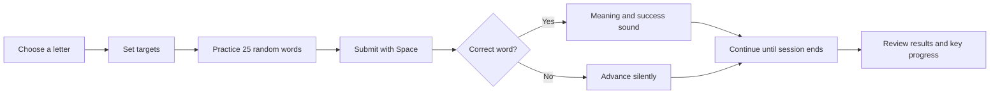

# WordStride overview

WordStride is a cyberpunk English typing trainer that combines letter-based practice with vocabulary discovery.

## Table of contents

- [Problem](#problem)
- [Solution](#solution)
- [Practice experience](#practice-experience)
- [Tech stack](#tech-stack)
- [Scope](#scope)
- [Future modes and next steps](#future-modes-and-next-steps)
- [Design references](#design-references)

## Problem

- Typing drills can improve speed without helping users understand the words they type.
- One overall score hides differences between practice sessions for different starting letters.
- Requiring an account adds friction to a short daily practice habit.

## Solution

- Practice random English words beginning with a chosen letter.
- Reveal meaning and usage after a correct word submission, when available.
- Set speed, accuracy, and daily goals independently for each letter.
- Keep settings and progress in the browser without an account.

## Practice experience

| Area | Current behavior |
| --- | --- |
| All Keys | A–Z start dark and unchecked; every letter is selectable. The selected letter is highlighted. |
| Targets | Click a key to configure it. Defaults: 45 WPM, 97% accuracy, 20 minutes daily. |
| Typing pad | Middle dots represent spaces. Space advances after correct, incorrect, or incomplete words. |
| Vocabulary | A correct submission selects the meaning card and plays sound when enabled. Missing definitions or examples are labelled. |
| Metrics | Live speed, selected key’s best WPM, accuracy, score, and daily progress; targets appear below All Keys. |
| Achievements | A completed session meeting both speed and accuracy targets earns a checkmark. Daily goals are separate. |
| Profile menu | Settings and Statistics, including an A–Z chart of best completed-session WPM. |
| Session | Ends after 25 words or the chosen 30, 60, or 120 seconds; pauses after 5 seconds without input. |

- **Visual direction:** dark surfaces, neon accents, clear typing feedback, and a minimal sci-fi interface.
- **Controls:** Backspace edits; Escape pauses; Enter or the resume overlay resumes; Tab loads a new batch; Shift+Tab leaves the typing area.
- **Focus:** leaving the typing area or hiding the browser tab pauses practice.
- **Meaning of a key:** “A” groups words starting with A; its WPM measures whole-word typing, not individual A keystrokes.

## Tech stack

| Layer | Technology |
| --- | --- |
| Application | React 19, TypeScript, Vite |
| Presentation | Plain CSS, bundled Space Grotesk, monospace typing font |
| Practice data | 26 static JSON word files, one per starting letter |
| Vocabulary | Free Dictionary API and bundled definitions |
| Persistence and audio | Browser localStorage and Web Audio API |
| Verification | Vitest, Playwright, dataset integrity script |

## Scope

- **Current:** English practice, configurable per-key goals, vocabulary feedback, sound, and local statistics.
- **Limits:** no accounts, cross-device sync, backend, or guaranteed dictionary coverage.
- **Future:** coding, clerical, and other focused practice modes; no mode selector is currently shown.

## Future modes and next steps

The following extensions are planned directions, not implemented features. Complete English practice before introducing another mode.

| Mode | Practice material | Feedback and progress |
| --- | --- | --- |
| English — available | Words grouped by starting letter | Meanings, examples, WPM, accuracy, and per-letter targets |
| Coding — proposed | Language-specific snippets, operators, brackets, and indentation | Exact typing accuracy, recurring syntax patterns, and progress by language or topic |
| Clerical — proposed | Synthetic names, addresses, dates, numbers, and structured records | Field accuracy, completed records, and progress by task type |

- **First:** stabilize English input, timing, persistence, and statistics; verify browser behavior.
- **Next:** define the smallest useful coding and clerical exercises, including how completion and accuracy are measured.
- **Then:** introduce shared session infrastructure with mode-specific content and input rules; pilot one new mode at a time.
- **Before release:** test profile migration and keep each mode’s goals, scores, and achievements independent. Add a mode selector when a second mode is usable.
- **Later extensions:** reuse the same approach for additional practice categories once their content and learning goals are defined.

See [extension design](03-architecture.md#extension-design-proposed) for the proposed boundaries and tradeoffs.

## Design references

- [Architecture](03-architecture.md): practice engine, data and storage, decisions and tradeoffs.
- [README](../README.md): setup and development commands.
