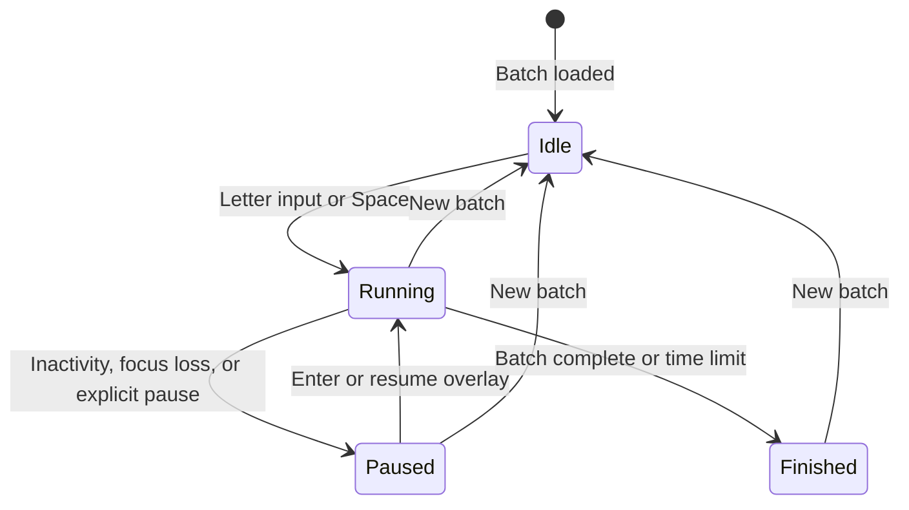
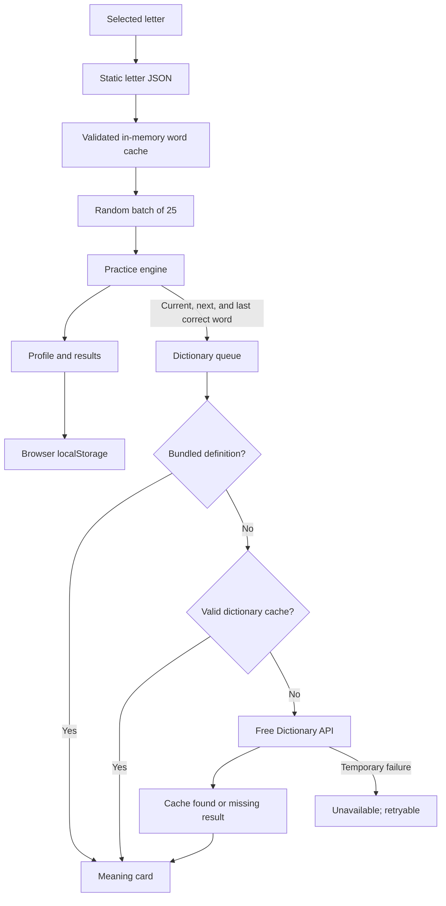
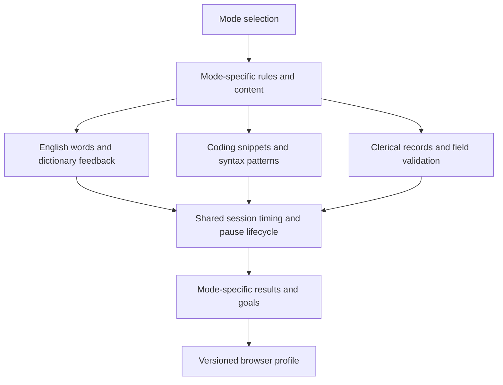

# WordStride architecture

Current design of the practice engine, data and storage, and their tradeoffs. See the [overview](01-overview.md) for the problem, solution, and tech stack.

## Table of contents

- [Practice engine](#practice-engine)
  - [Session lifecycle](#session-lifecycle)
  - [Input and scoring](#input-and-scoring)
  - [Targets and achievements](#targets-and-achievements)
- [Data and storage](#data-and-storage)
  - [Word selection](#word-selection)
  - [Dictionary enrichment](#dictionary-enrichment)
  - [Saved progress](#saved-progress)
- [Decisions and tradeoffs](#decisions-and-tradeoffs)
  - [Extension design — proposed](#extension-design-proposed)

## Practice engine

- **Problem:** timing, corrections, pauses, and goals must produce consistent results.
- **Solution:** a pure reducer owns session transitions and scoring; the application supplies input, elapsed-time updates, and browser side effects.
- **State:** the profile holds durable progress; the session holds the current batch, input, counters, and status.
- **Implementation:** [engine](../src/features/practice/model/engine.ts), [types](../src/features/practice/model/types.ts), and [application integration](../src/app/App.tsx).

### Session lifecycle

- Duration is captured at session creation: 30, 60, or 120 seconds; default 120.
- Only running time contributes to elapsed time and daily practice totals.
- After 5 seconds without input, pause at that boundary; those initial 5 seconds count.
- Escape, focus loss, hidden tabs, and settings dialogs can also pause practice.
- Restarting discards the unfinished session result; already accumulated daily time and score remain.

### Input and scoring

| Input or metric | Rule |
| --- | --- |
| Letter | Records an attempt; a matching character at the current position records a hit. Matching is case-sensitive. |
| Backspace | Edits the current word; does not erase previous attempts or mistakes. |
| Space | Submits and advances. An exact match updates the meaning card and triggers enabled success sound; other submissions keep the previous meaning. |
| Omitted characters | Count as unsuccessful attempts when Space submits an incomplete word. |
| WPM | `(correctly submitted characters / 5) / running minutes`; includes one space per correct word; zero before one second. |
| Accuracy | `hits / attempts × 100`; starts at 100% before any attempts. Space and Backspace are not character attempts. |
| Score | 10 points per letter in each correctly submitted word. |

- Paste is disabled in the typing input.
- Incorrect words contribute no WPM characters or score, even when some letters matched.

### Targets and achievements

- Each letter defaults to **45 WPM**, **97% accuracy**, and **20 daily minutes**.
- Configurable integer ranges: WPM 1–300; accuracy 1–100%; daily goal 1–240 minutes.
- A session snapshots its targets so later configuration does not alter its qualification rules.
- A finished session earns the letter’s checkmark when both targets are met, at least one word is correct, and elapsed time is at least one second.
- Daily goals track independently; previously earned checkmarks remain after target changes.
- Best WPM and recent results update on completion, whether or not targets were met.

## Data and storage

- **Problem:** practice needs reliable word batches, optional meanings, and persistent progress without a backend.
- **Solution:** serve static word files, enrich words asynchronously, and save the profile locally.

### Word selection

- **Source:** 29,490 entries from the MIT-licensed zxcvbn English Wikipedia frequency corpus. See [provenance and license evidence](../third-party/zxcvbn/SOURCE.md).
- **Files:** `public/words/en/a.json` through `z.json`; sorted, unique lowercase words.
- **Generation:** pinned source → filter and deduplicate → alphabetical partition → files and hash manifest.
- **Loading:** fetch only the selected letter; validate content and cache successful responses in memory. Failed loads remain retryable.
- **Sampling:** partial Fisher–Yates selects 25 distinct words; later batches may repeat them. There is no exhausted-word state.
- **Boundary:** words use the full alphabet; selecting A only restricts their starting letter.
- **Limit:** this is a frequency corpus, not an exhaustive dictionary; names, abbreviations, and uncommon terms may remain.
- **Implementation:** [word source](../src/features/practice/services/word-source.ts).

### Dictionary enrichment

| Concern | Behavior |
| --- | --- |
| Lookup order | Bundled definitions → valid cache → Free Dictionary API |
| Remote endpoint | `https://api.dictionaryapi.dev/api/v2/entries/en/{word}` |
| Scheduling | Up to three concurrent lookups; duplicate work is suppressed. Requests survive word advances. |
| Prefetch | Look up the current and next word ahead of submission, plus the last correctly submitted word. |
| UI consistency | Results are keyed by word; a late response does not select an older word. |
| Cache | `wordstride.dictionary.v1`; memory and localStorage; at most 200 entries |
| Expiry | Found: 30 days; missing: 1 day |
| Failure | Five-second timeout; transient failures are not cached and may be retried. Typing continues. |
| Display | Meaning, example when available, and a dictionary source link for remote definitions |

- Bundled entries are checked first; they provide limited offline coverage.
- Missing examples stay missing rather than being generated. Remote requests send the individual word to the dictionary service.
- **Implementation:** [dictionary lookup](../src/features/vocabulary/services/dictionary.ts) and [request queue](../src/features/vocabulary/services/dictionary-queue.ts).

### Saved progress

| Data | Persistence |
| --- | --- |
| Profile | localStorage key `wordstride.profile.v1`, internal schema version 2 |
| Per letter | Targets, checkmark, best WPM, daily running milliseconds, recent results |
| Global | Selected letter, settings, best WPM, score, daily totals, recent results |
| History | Latest 20 completed results globally and per letter |
| Daily totals | Local calendar dates; loading retains the latest 90 date entries |
| Active session | Memory only; unfinished word input is not restored on reload |

- Loading validates stored fields and replaces invalid values with defaults.
- Version 1 migration preserves settings, global statistics, and history; old sequential unlocks do not become earned checkmarks.
- Storage failures do not block practice; clearing browser data removes saved progress. No cross-device sync exists.
- Open tabs detect profile changes before saving, on storage/focus events, and every second. External changes replace the local profile and discard the active session; deleting the profile resets progress. Clearing only cached files does not clear localStorage.
- **Implementation:** [profile storage](../src/features/practice/model/profile-storage.ts); saving is coordinated in the application.

## Decisions and tradeoffs

| Decision | Benefit | Tradeoff |
| --- | --- | --- |
| Static letter files | Reproducible batches without a word-list API dependency | Corpus updates require regeneration; coverage is finite |
| Random batches | Repeatable practice without an end-of-list state | Words can recur between batches |
| Asynchronous meanings | Dictionary latency does not interrupt typing | Meanings may arrive late or be unavailable |
| Browser-only profile | Immediate use without accounts or backend operations | Progress stays in one browser and can be cleared |
| Reducer-based scoring | Explicit, testable rules independent of browser effects | Timing and persistence still need application integration |
| Completed-session achievements | Rewards sustained performance against personal targets | An abandoned session cannot earn a checkmark or best WPM |
| Add modes after English is stable | Validates the core experience before expanding scope | Coding and clerical exercises need distinct input and scoring rules |

### Extension design — proposed

- **Problem:** the current engine assumes A–Z selection, letter input, and Space submission. Coding and clerical exercises do not fit those rules.
- **Solution:** extract shared session timing and pause behavior; let each mode define content, accepted input, completion, scoring, and optional explanatory feedback.
- **Status:** this is a future refactor, not an existing plugin system. English remains the only implemented mode.

| Boundary | Proposed responsibility | Tradeoff |
| --- | --- | --- |
| Content | A provider per mode; licensed snippets and synthetic clerical records with reproducible generation | More datasets to maintain; no need to force every exercise into alphabet files |
| Input | English keeps Space submission; coding accepts symbols and whitespace; clerical defines field navigation and submission | Tab and Enter can become input, so shortcuts and keyboard escape routes must be redesigned per mode |
| Evaluation | Each mode defines exact-match rules, omissions, formatting tolerance, and completion units | WPM and scores are not automatically comparable across modes |
| Feedback | English meanings, optional coding explanations, or clerical field corrections | Dictionary lookup remains specific to English; typing snippets does not require executing code |
| Storage | Separate targets, best results, history, and achievements by mode and exercise category | Requires a versioned migration preserving current English progress |
| Shared interface | Reuse timer, pause controls, sound preference, and result presentation where appropriate | A–Z keys and word-level sound triggers are not suitable for every mode |

**Implementation sequence**

1. Define one small exercise and its scoring rules for the next mode before designing a general framework.
2. Introduce a mode identifier and migrate existing progress into the English section of the profile; retain current targets and achievements.
3. Extract shared session behavior and implement the new content, input, and evaluation rules without changing English scoring.
4. Add mode selection and category-specific statistics; keep English selected by default for existing users.
5. Verify whitespace and field navigation, pause/resume, independent statistics, storage clearing, and migration before adding another mode.
